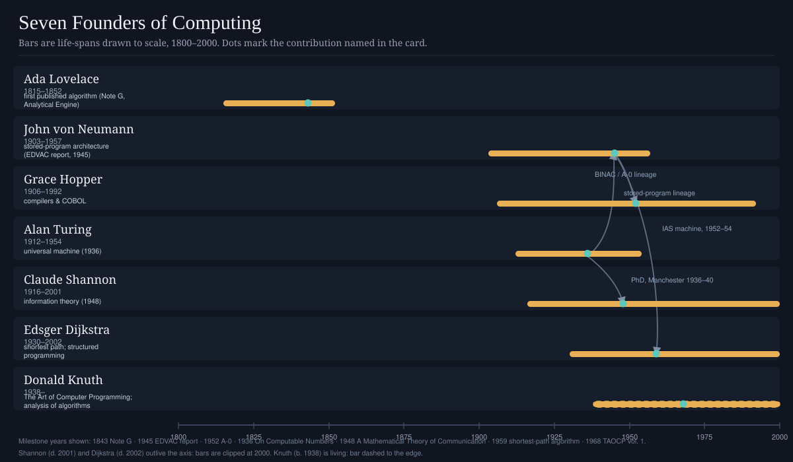
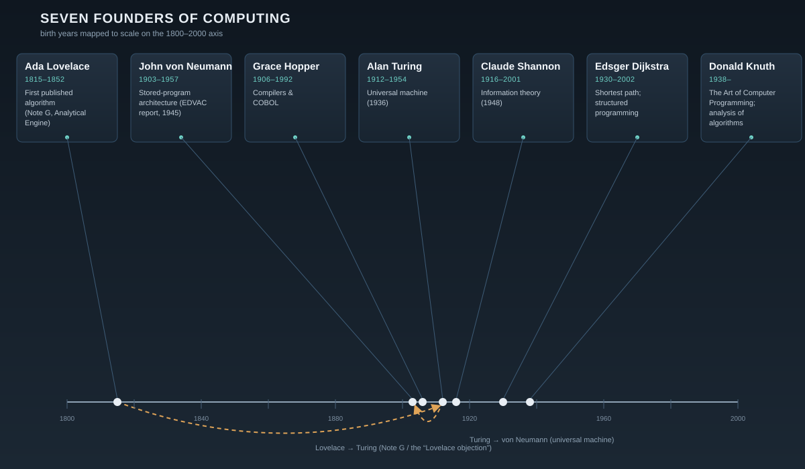
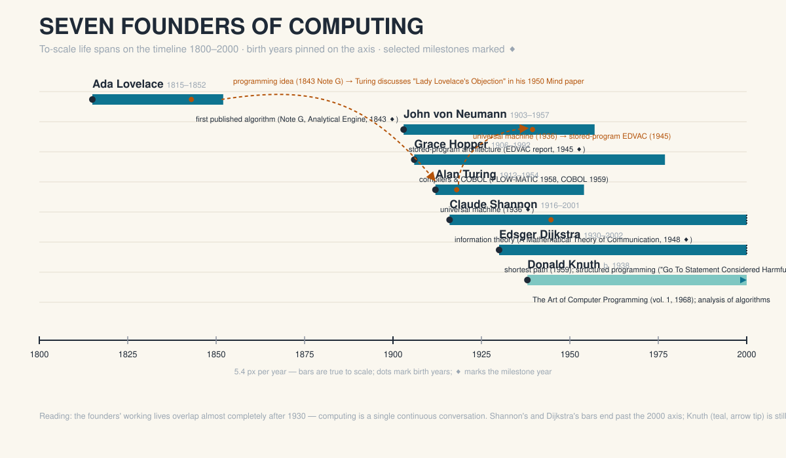
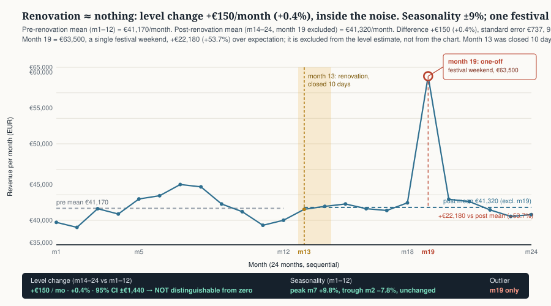
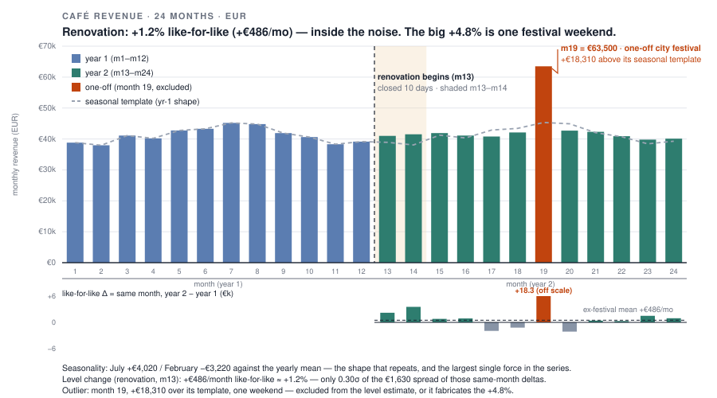
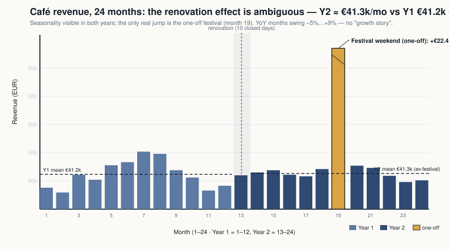

# ⚡ NikBench v2.0 — the peer-judged LLM benchmark

   

**NikBench measures what models can *do* and *think* — not what they can memorize.** Paste `test.md` into a fresh chat with any model, and the packet runs the whole pipeline itself: blind build → peer review (every model rates every other model, plus honest self-rating) → leaderboard refresh with `git push`.

> 🔒 **No answer key exists anywhere in this repo.** Ten tasks are famously derivable classics (judges re-solve them independently); six are famous open problems that *have no answers* — the models are graded on the quality and honesty of their thought; the rest are contract specs.

## 🧩 The six pillars

| Pillar | Tasks | What it tests | Weight |
|---|---|---|---:|
| 🧩 **RAT** — Ratiocination | R1–R10 | 10 monster classics: Boolos's *Hardest Logic Puzzle Ever*, Blue Eyes, Cheryl's Birthday (+ its sequel!), the 1962 Zebra Puzzle, the ant on the stretching band, the prisoners & the lamp, two eggs, the fly & the trains, twelve coins | 20% |
| 🧠 **THO** — Thought | T1–T6 | famous **open/unsolved** questions — P vs NP, Navier–Stokes (Clay), Riemann, the quantum measurement problem, Sleeping Beauty, "what is life?" — graded on comprehension, accurate survey, original attack, rigor, **candor** | 20% |
| 🎨 **VIS** — Visual craft | V1–V4 | SVG recreation of the Mona Lisa · "Seven Founders of Computing" infographic (fact-checked) · a **60-second looping LIFTOFF motion graphic** in one HTML file · a data-visualization with a built-in **outlier honesty trap** | 15% |
| 🧮 **ALG** — Algorithm design | A1–A3 | O(1) KV store with O(k) prefix-scan · streaming distinct-count sketches · sharding a melting hot-key hashtag counter | 15% |
| 🪟 **FE** — Frontend | F1 | "Mission Control": live clock, seeded metrics, countdown, sortable satellite table, canvas telemetry, localStorage, themes, responsive, a11y | 15% |
| ⚙️ **BE** — Backend | B1 | "Clinic Appointment API": bare-Node router, error envelope, booking-overlap state machine, 5 design questions | 15% |

Full rubric criteria: [`judging/judge.md`](judging/judge.md) · task provenance (all verbatim-sourced, links checked): [`docs/methodology.md`](docs/methodology.md)

## ⚡ Quickstart — one packet does everything (idempotent)

**You only ever send `test.md`. The packet routes itself into the right phase:**

```
fresh chat + test.md  ──►  no submission yet?     → PHASE 1: blind build → saves submissions/<model>.md → "PHASE 1 COMPLETE"
(fresh chat) test.md  ──►  submission exists?     → PHASE GATE: peers ready?
                          yes → PHASE 2: reads every submission → rates 6 pillars → own row LAST (self)
                                 → saves peer/<model>.md → "PEER REVIEW WRITTEN"
                          peer file exists already → PHASE 3: runs scripts/aggregate.py → refreshes the
                                 leaderboard block in THIS README → git commit + push → "PHASE 3 COMPLETE"
```

```bash
# the packet embeds this logic; the script is also usable standalone:
python scripts/aggregate.py scorecards --peer-dir peer -o leaderboard.md
```

Two-phase runs stay perfectly comparable: Phase 1 is a **blind, single-generation** build (no reading of other submissions, no rubric, no internet). Phase 2 is where every model sees everyone's work and votes — **its own row last**. Deep-graded path (calibrated rubric judges, optional): [`judging/judge.md`](judging/judge.md).

Full protocol & provenance: [`docs/methodology.md`](docs/methodology.md).

## 📊 Live board (auto-updated by Phase 3 runs)

<!-- NIKBENCH:LEADERBOARD:START -->
_Last updated: 2026-10-18 01:40 UTC · scorer: `scripts/aggregate.py` · protocol: `docs/methodology.md`_

| Rank | Model | Final | Grade | NBS | Peer | Self | RAT | THO | VIS | ALG | FE | BE | Judges | Spread |
|---:|---|---:|:--:|---:|---:|---:|---:|---:|---:|---:|---:|---:|:--:|---:|
| 1 | **beam-free** | 91.26 | S | 100.0 | 71.3 | 85.0 | 100 | 100 | 100 | 100 | 100 | 100 | 1 | ±0.0 |
| 2 | **nemotron-3.5-super-vl-free** | 87.98 | A | 91.8 | 79.4 | 85.0 | 72 | 89 | 100 | 98 | 100 | 100 | 1 | ±0.0 |
| 3 | **big-pickle** | 85.93 | A | — | 86.9 | 85.0 | — | — | — | — | — | — | 0 | ±0.0 |
| 4 | **glm-5.3-flash-free** | 82.22 | A | — | 81.4 | 83.0 | — | — | — | — | — | — | 0 | ±0.0 |
| 5 | **space-bunny-free** | 73.07 | B | — | 76.1 | 70.0 | — | — | — | — | — | — | 0 | ±0.0 |
| 6 | **deepseek-v4.1-flash-free** | 71.36 | B | 62.5 | 84.1 | 85.0 | 36 | 50 | 76 | 68 | 82 | 77 | 1 | ±0.0 |
| 7 | **longcat-2.5-preview-free** | 66.85 | C | — | 68.7 | 65.0 | — | — | — | — | — | — | 0 | ±0.0 |
| 8 | **mimo-v2.6-flash-free** | 37.31 | F | 36.0 | 33.6 | 45.0 | 97 | 83 | 0 | 0 | 0 | 0 | 1 | ±0.0 |

## Grade scale

| Grade | Score | Meaning |
|:--:|---:|---|
| S | ≥ 90 | frontier: production-grade on all six pillars |
| A | ≥ 80 | excellent, minor gaps |
| B | ≥ 70 | solid generalist |
| C | ≥ 60 | functional, notable gaps |
| D | ≥ 45 | incomplete work on at least one pillar |
| F | < 45 | failed to produce usable submissions |

**NBS** = rubric-judge score (weighted across the 6 pillar medians) · **Peer** = mean of the other models' ratings · **Self** = the model's own rating of itself (last, by design) · **Final** = `0.6·NBS + 0.2·Peer + 0.2·Self`. Pillars: **RAT** ratiocination · **THO** thought · **VIS** visual · **ALG** algorithms · **FE** frontend · **BE** backend. Grades follow **Final** when peer data exists.

<details>
<summary><b>Peer-round notes</b></summary>

### Peer-round notes

- **beam-free**: peer 71.3/100 from 7 reviewer(s), self 85.0/100
- **big-pickle**: peer 86.9/100 from 7 reviewer(s), self 85.0/100
- **deepseek-v4.1-flash-free**: peer 84.1/100 from 7 reviewer(s), self 85.0/100
- **glm-5.3-flash-free**: peer 81.4/100 from 7 reviewer(s), self 83.0/100
- **longcat-2.5-preview-free**: peer 68.7/100 from 7 reviewer(s), self 65.0/100
- **mimo-v2.6-flash-free**: peer 33.6/100 from 7 reviewer(s), self 45.0/100
- **nemotron-3.5-super-vl-free**: peer 79.4/100 from 7 reviewer(s), self 85.0/100
- **space-bunny-free**: peer 76.1/100 from 7 reviewer(s), self 70.0/100

</details>


<details>
<summary><b>Per-judge details</b> (click to expand)</summary>

### beam-free — NBS 100.00 (S)

| Judge | RAT | THO | VIS | ALG | FE | BE | Judge overall |
|---|---:|---:|---:|---:|---:|---:|---:|
| cohere-north-mini | 100.0 | 100.0 | 100.0 | 100.0 | 100.0 | 100.0 | 100.0 |

Flags:
- judge:cohere-north-mini: parser-salvaged: original card had invalid JSON (likely unescaped quotes); every score value below extracted verbatim from the raw judge output

### deepseek-v4.1-flash-free — NBS 62.55 (C)

| Judge | RAT | THO | VIS | ALG | FE | BE | Judge overall |
|---|---:|---:|---:|---:|---:|---:|---:|
| cohere-north-mini | 36.0 | 49.5 | 76.0 | 68.0 | 82.0 | 77.0 | 62.5 |

Flags:
- judge:cohere-north-mini: parser-salvaged: original card had invalid JSON (likely unescaped quotes); every score value below extracted verbatim from the raw judge output

### mimo-v2.6-flash-free — NBS 36.00 (F)

| Judge | RAT | THO | VIS | ALG | FE | BE | Judge overall |
|---|---:|---:|---:|---:|---:|---:|---:|
| cohere-north-mini | 97.0 | 83.0 | 0.0 | 0.0 | 0.0 | 0.0 | 36.0 |

Flags:
- judge:cohere-north-mini: judge said: all VIS/ALG/FE/BE pillars absent - only RAT and THO content present
- judge:cohere-north-mini: judge said: candidate submission incomplete: V/A/F/B sections missing due to repeated session failures
- judge:cohere-north-mini: parser-salvaged: original card had invalid JSON (likely unescaped quotes); every score value below extracted verbatim from the raw judge output

### nemotron-3.5-super-vl-free — NBS 91.83 (S)

| Judge | RAT | THO | VIS | ALG | FE | BE | Judge overall |
|---|---:|---:|---:|---:|---:|---:|---:|
| cohere-north-mini | 72.0 | 89.0 | 100.0 | 97.5 | 100.0 | 100.0 | 91.8 |

Flags:
- judge:cohere-north-mini: parser-salvaged: original card had invalid JSON (likely unescaped quotes); every score value below extracted verbatim from the raw judge output

</details>

<!-- NIKBENCH:LEADERBOARD:END -->

## 🖼️ Visual showcase — what the models actually made

The VIS pillar is scored on what a model *draws, animates, and charts* — not what it describes. GitHub renders SVG in color; round-1 curation is the three strongest VIS builds by peer vote (space-bunny-free **81.4**, big-pickle **80.7**, glm **78.6** /100 from the 7 non-self reviewers). Regenerate after any round: `python scripts/build_gallery.py`.

### V1 — Mona Lisa in ≤300 SVG shapes

Blind art fidelity: painters pose, folded hands, sfumato smile, from a text spec with no reference image. Peer-judged for recognizability and craft.

| Model | Render (in color, straight from the submission) | Peer VIS /100 |
|---|---|---:|
| **space-bunny** |  | 81.4 |
| **big-pickle** |  | 80.7 |
| **glm-5.3-flash** |  | 78.6 |

### V2 — Seven Founders infographic (1200×700)

Fixed roster — Lovelace · Turing · von Neumann · Shannon · Hopper · Dijkstra · Knuth — on a *to-scale* 1800–2000 timeline. Wrong facts or wrong spacing = lost points.

| Model | Render (in color, straight from the submission) | Peer VIS /100 |
|---|---|---:|
| **space-bunny** |  | 81.4 |
| **big-pickle** |  | 80.7 |
| **glm-5.3-flash** |  | 78.6 |

### V3 — LIFTOFF: 60-second motion loop (HTML/CSS)

A 60-second animated web “video” with 4 timed beats. GitHub sandboxes scripts, so open these files in a browser to watch them loop — they are the real deliverables.

| Model | Open in browser (GitHub won't run it) | Peer VIS /100 |
|---|---|---:|
| **space-bunny** | [`gallery/space-bunny-free_liftoff.html`](gallery/space-bunny-free_liftoff.html) | 81.4 |
| **big-pickle** | [`gallery/big-pickle_liftoff.html`](gallery/big-pickle_liftoff.html) | 80.7 |
| **glm-5.3-flash** | [`gallery/glm-5-3-flash-free_liftoff.html`](gallery/glm-5-3-flash-free_liftoff.html) | 78.6 |

### V4 — Café revenue chart with an honesty trap (900×500)

Same CSV for every model. The trap: noise invites a big “trend”, the truth is a renovation effect ≈ nil and a single festival outlier at month 19. Reward goes to models that decompose instead of dramatize.

| Model | Render (in color, straight from the submission) | Peer VIS /100 |
|---|---|---:|
| **space-bunny** |  | 81.4 |
| **big-pickle** |  | 80.7 |
| **glm-5.3-flash** |  | 78.6 |

### Bonus — F1 Mission Control (single-file dashboard)

The frontend task is visual too: a 10-requirement dashboard app. Open the real files.

| Model | Open in browser (GitHub won't run it) | Peer VIS /100 |
|---|---|---:|
| **space-bunny** | [`gallery/space-bunny-free_mission-control.html`](gallery/space-bunny-free_mission-control.html) | 81.4 |
| **big-pickle** | [`gallery/big-pickle_mission-control.html`](gallery/big-pickle_mission-control.html) | 80.7 |
| **glm-5.3-flash** | [`gallery/glm-5-3-flash-free_mission-control.html`](gallery/glm-5-3-flash-free_mission-control.html) | 78.6 |

_Full raw builds (all 8 models, all 4 visual tasks plus F1) live in `submissions/`
between rounds; the renders above are extracted verbatim by
`scripts/build_gallery.py` — no retouching. **Round-1 extras:** the three
featured B1 Clinic-API servers additionally pass a live contract smoke test
(`python scripts/smoke_b1.py`, Node run): create doctor → book **201** →
double-book **409 SLOT_TAKEN** → delete **204** → gone **404**, with clean
validation errors on malformed input._

## 🗂️ Repository map

```
nikBench/
├── test.md                     ← 🔫 THE one packet: routing → blind build (25 tasks) → peer+self → board refresh
├── judging/
│   ├── judge.md                ← 🧑‍⚖️ optional calibrated rubric judges (paste + submission → JSON scorecard)
│   └── peer-review.md          ← reference copy of the peer round (test.md embeds it)
├── docs/
│   └── methodology.md          ← full protocol, verbatim task provenance (checked 2026-10-18), dispute rules
├── submissions/                ← candidate raw replies, one <model-name>.md each
├── peer/                       ← peer-round rating tables + self rows (one <model-name>.md each)
├── scorecards/                 ← optional rubric judge JSON outputs
├── templates/scorecard.json    ← blank scorecard shape (6 pillars)
├── examples/                   ← worked example: 3 judges scoring a demo candidate → example board
├── gallery/                    ← committed color renders from the latest round (README shows the VIS showcase)
├── scripts/aggregate.py        ← stdlib-only scorer → leaderboard.md (supports --selftest, peer-only boards)
├── leaderboard.md              ← canonical generated board
└── .github/workflows/ci.yml    ← validates the scorer on every push
```

## 🧠 Why "no answer key"?

Because the interesting part isn't whether a model *knows* that Boolos's gods can be disambiguated — it's whether it can:

- derive the full case tree instead of reciting it,
- write a dossier on P vs NP that names the *actual* barrier results without inventing citations (and without claiming to solve it!),
- draw a Mona Lisa that reads at thumbnail size in ≤300 SVG elements,
- keep a 60-second motion loop seamless,
- refuse to sell a "+25% growth" story when month 19 is a festival outlier and the renovation did nothing.

Peer votes make this robust: every model rates every other **before** rating itself (self-inflation lands in its own labeled column). The rubric-judge path exists for when you want panel medians with outlier flags (σ > 15 triggers disputes; disputed items are re-solved blind by panel majority).

## 🏅 Grading scale

| Grade | Score | Meaning |
|:--:|---:|---|
| S | ≥ 90 | frontier: production-grade on all six pillars |
| A | ≥ 80 | excellent, minor gaps |
| B | ≥ 70 | solid generalist |
| C | ≥ 60 | functional, notable gaps |
| D | ≥ 45 | incomplete work on at least one pillar |
| F | < 45 | failed to produce usable submissions |
