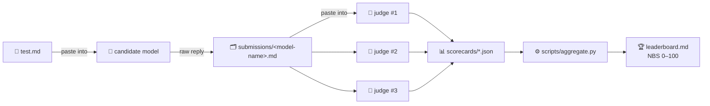

<div align="center">

# 🚀 NikBench

### The peer-judged benchmark for reasoning · frontend · backend

**One model builds it — every other model rates it.**

[](#-quickstart)
[](#-the-three-pillars)
[](#-how-judging-works)
[-red)](docs/methodology.md#4-contamination-policy)
[](LICENSE)
[](scripts/aggregate.py)

</div>

---

## 🎯 What is NikBench?

Most benchmarks grade a model against **hidden answer keys**. NikBench does something different:

> A candidate model receives one packet — `test.md` — and completes three real-world tasks in a single reply.
> That raw reply becomes a submission. Then **independent judge models** (from different families, in fresh chats) read the submission, solve the tasks themselves, and score it against a fixed rubric.
> Machine-scorecards go into one script: out comes a single **NikBench Score (NBS)** on a 0–100 scale.

No answer keys are published anywhere in this repo. Judges must actually think.



---

## 🔋 The three pillars

| Pillar | What the model must do | How it's verified |
|---|---|---|
| 🧠 **Reasoning** | Solve 10 tasks **sourced verbatim from public benchmarks** — [GSM8K](https://github.com/openai/grade-school-math), [AQuA-RAT](https://github.com/google-deepmind/AQuA), [BIG-Bench Hard](https://github.com/suzgunmirac/BIG-Bench-Hard) | Each judge solves every task independently; majority verdict; disputed tasks score 0.5 |
| 🎨 **Frontend** | Build *"Mission Control"* — a complete single-file app: live clock, seeded telemetry, canvas chart, sortable satellite table, anomaly feed, localStorage, themes, a11y, responsive | Judges trace the code requirement-by-requirement (10 checklist items) |
| ⚙️ **Backend** | Build the *"Clinic Appointment API"* — dependency-free Node server, 8 endpoints, strict error envelope, 6 ordering-sensitive invariants + 5 system-design answers | Judges mentally execute each endpoint against the spec's edge cases |

---

## ⚡ Quickstart

**Step 1 — Test the model** *(the part you asked for: just send `test.md`)*

1. Paste the full contents of **[`test.md`](test.md)** into a **fresh chat** with the model under test (default settings, no tools).
2. Save its entire reply → **`submissions/<model-name>.md`** *(e.g. `submissions/gpt-5.2.md`)*

**Step 2 — Let other models rate it**

3. Open a fresh chat with a **different** model family → paste **[`judging/judge.md`](judging/judge.md)** → paste the submission.
4. The judge returns one JSON scorecard → save to **`scorecards/<judge>__<model-name>.json`**
5. Repeat for **≥ 3 judges** (≥ 2 different families, judge ≠ candidate).

**Step 3 — Aggregate the ranking**

```bash
python scripts/aggregate.py scorecards -o leaderboard.md
```

Commit the scorecards + leaderboard. Done. (Full protocol: [`docs/methodology.md`](docs/methodology.md).)

---

## 🏅 Grading

| Grade | NBS | Meaning |
|:--:|---:|---|
| 🟣 **S** | ≥ 90 | frontier — production-grade on all three pillars |
| 🟢 **A** | ≥ 80 | excellent, minor gaps |
| 🔵 **B** | ≥ 70 | solid generalist |
| 🟡 **C** | ≥ 60 | functional, notable gaps |
| 🟠 **D** | ≥ 45 | incomplete work on at least one pillar |
| 🔴 **F** | < 45 | failed to produce usable submissions |

**NBS** = mean of the three pillar **medians** across judges. Judge agreement appears as `Spread`; a judge drifting > 15 points from the median is flagged for review, never silently dropped.

See a fully worked example scorecard run with three demo judges in [`examples/`](examples/scorecards/) → rendered result: [`examples/leaderboard-example.md`](examples/leaderboard-example.md).

---

## 🗂️ Repository map

```
nikBench/
├── test.md                     ← 🔫 THE packet you paste into any model under test
├── judging/
│   └── judge.md                ← 🧑‍⚖️ THE judge prompt (paste + submission → JSON scorecard)
├── docs/
│   └── methodology.md          ← full protocol, task provenance, contamination policy
├── submissions/                ← candidate raw replies, one <model-name>.md each
├── scorecards/                 ← judge JSON outputs, one file per judge × candidate
├── templates/scorecard.json    ← blank scorecard shape
├── examples/                   ← worked example: 3 judges scoring a demo candidate
├── scripts/aggregate.py        ← stdlib-only scorer → leaderboard.md (supports --selftest)
├── leaderboard.md              ← official board
└── .github/workflows/ci.yml    ← validates the scorer on every push
```

---

## 🔒 Design decisions

- **Why no answer key?** — Anything published on GitHub can be read by the very models being tested. NikBench instead makes judges *resolve the tasks live* and cross-check each other. Disputes resolve to majority, then 0.5, then review.
- **Why real benchmark tasks?** — GSM8K / AQuA / BBH items are graded-quality tasks with known-good structure; using them keeps the test honest against the internet's real eval distribution. Full provenance table: [`docs/methodology.md §3`](docs/methodology.md#3-task-provenance--attribution).
- **Why peer judging?** — Open-ended frontend/backend work has no `assert`-able truth; calibrated human-style review generalizes, and averaging ≥ 3 independent judges suppresses single-model bias (this is the MT-Bench / Chatbot-Arena lesson, applied to engineering tasks).
- **Why median, not mean?** — Median pillar scores make the aggregate robust to one berserk judge.

---

## ❓ FAQ

<details>
<summary><b>Can a model judge itself?</b></summary>
No. Judges must come from different families than the candidate. Self-judging biases pillar scores measurably.
</details>

<details>
<summary><b>The model responded in chat format / refused the contract — is it graded?</b></summary>
It is graded as submitted. Judges score what's on the page; missing sections earn zeros for the affected pillars. Contract violations show up naturally on <code>clarity</code>.
</details>

<details>
<summary><b>Judges disagree on a reasoning task — who wins?</b></summary>
Majority of judges. No majority ⇒ the task counts 0.5 for <code>correct_count</code>. All in <a href="docs/methodology.md#2-scoring-model">§2 of the methodology</a>.
</details>

<details>
<summary><b>Do judge quality differences matter?</b></summary>
Use ≥ 3 strong judges and ≥ 2 families; report judge IDs (they're stored in every scorecard, and the per-judge breakdown is published in the leaderboard's collapsed details).
</details>

<details>
<summary><b>Contamination — models may know GSM8K/BBH items.</b></summary>
Yes, accepted and documented (§4). Mitigations: derivations are graded (memorized answers tank <code>rigor</code>), all models face the same items, and v1.1 adds a seeded rotation from held-out splits.
</details>

---

## 🗺️ Roadmap

| Version | Scope |
|---|---|
| **v1.0** ✅ | 3-pillar packet: 10 sourced reasoning tasks + frontend flagship + backend flagship |
| **v1.1** 🔜 | Seeded task rotation (held-out pools), more BBH families, judge calibration sets |
| **v1.2** 🧭 | Agentic tasks (tools allowed), multimodal frontend review (judges receive rendered screenshots) |
| **v1.3** 🌐 | Community leaderboard CI: PRs auto-recompute `leaderboard.md` |

---

## 🤝 Contributing

- Praise ≠ rating: scorecards must argue from code and derivations, not vibes — see the calibration rules at the top of [`judging/judge.md`](judging/judge.md).
- New task packs welcome — follow the provenance table format in `docs/methodology.md §3` and cite dataset + license.
- Ship scorecards, not vibes: to add a model to the leaderboard, open a PR with its submission file + ≥ 3 judge scorecards.

## 🙏 Credits

Built on the shoulders of open evals: **GSM8K** (OpenAI, MIT) · **AQuA-RAT** (Google DeepMind, Apache-2.0) · **BIG-Bench Hard** (Suzgun et al., MIT). Protocol inspiration: MT-Bench, Chatbot Arena, and the LLM-as-judge literature.

<div align="center">

**⭐ If you run a model through NikBench, PR your scorecard — every honest number makes the board better. ⭐**

</div>
